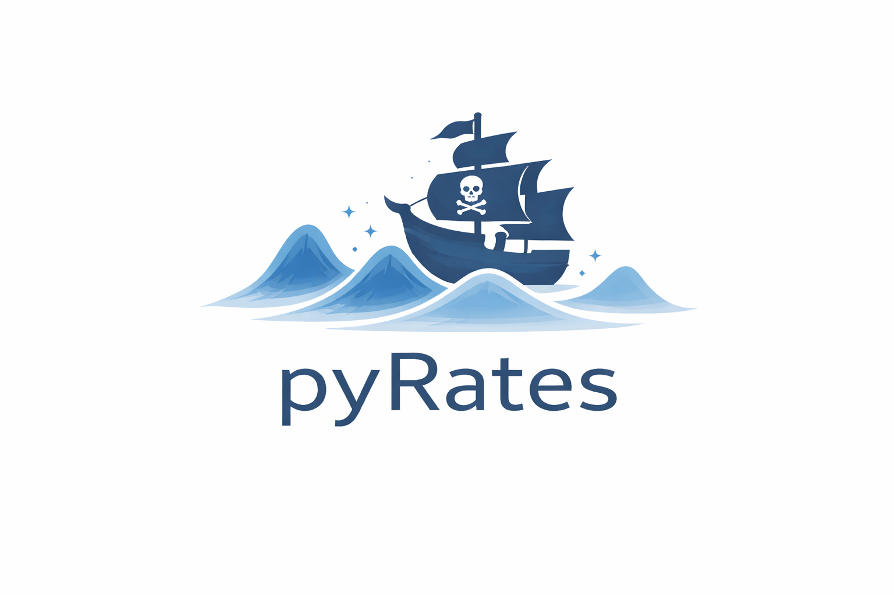

# pyRates

Framework for predicting properties of excited states.



## Installation

### Requirements

- Python >= 3.12
- Linux
- [uv](https://github.com/astral-sh/uv)
- [CUDA Toolkit](https://developer.nvidia.com/cuda-toolkit) (optional, for GPU support)

### Setup

1. **Clone the repository:**
   ```bash
   git clone https://github.com/le-schlo/pyRates.git
   cd pyRates
   ```

2. **Set up environment and install dependencies:**
   Create a virtual environment and install dependencies from `pyproject.toml` using `uv`.
   ```bash
   uv venv
   source .venv/bin/activate
   uv pip install -e .
   ```

## Structure

- `pyRates/`: Core library.
  - `Energy/`: Marcus theory and energy calculations.
  - `Model/`: Neural network architectures.
    - `FeedForwardModel/`: Mixture Density Network (MDN) head.
    - `MessagePassingModel/`: Graph encoders (D-MPNN, GAT, GIN, Transformer, MPNN).
    - `MPNN_MDN.py`: Main model, combines graph encoder with MDN.
    - `Inference.py`: Inference routines.
    - `Loss.py`: Loss functions for model training and evaluation.
    - `Training.py`: Training routines, optimization, and model fitting.
  - `Utilities/`: Utility functions.
    - `Dataset/`: Data loading, graph construction, one-hot encoding.
    - `Metrics/`: Metrics (Jaccard, Ranked Score).
    - `Plotting/`: Visualization tools.

## Modules

### Graph Encoder (`pyRates.Model.MessagePassingModel`)
Supports various graph encoder architectures, selectable via the `encoder_type` parameter in `MPNN_MDN`:

- **D-MPNN (`dmpnn`)**: Directed Message Passing Neural Network.
- **GAT (`gat`)**: Graph Attention Network with edge features.
- **MPNN (`mpnn`)**: Standard Message Passing Neural Network with GRU.
- **GIN (`gin`)**: Graph Isomorphism Network (GINEConv).
- **Graph Transformer (`transformer`)**: Native Graph Transformer.
- **Transformer_v2 (`transformer_v2`)**: Advanced Graph Transformer with architectural improvements like residual connections, normalization and FFN.

### Mixture Density Network (`pyRates.Model.FeedForwardModel.MixtureDensityNetwork`)
The model outputs parameters for a Gaussian Mixture Model (means, standard deviations, weights):
- Predicts probability distributions for targets.
- Captures uncertainty and multimodal outputs.

### Data Handling (`pyRates.Utilities.Dataset`)
- **Graph construction**: Converts SMILES strings to graph objects (`torch_geometric.data.Data`).
- **Featurization**: Atom features typically include atom type, degree, formal charge, hybridization, aromaticity, and chirality. Bond features include bond type, conjugation, ring membership, and stereochemistry. All features are encoded using one-hot or categorical encoding, enabling the models to process molecular graphs efficiently.
- **Normalization**: StandardScaler is used for target values to ensure stable training.

### Visualization and Metrics
- Plotting modules for scatter plots and mode visualization.
- Metrics such as Jaccard and Ranked Score.
